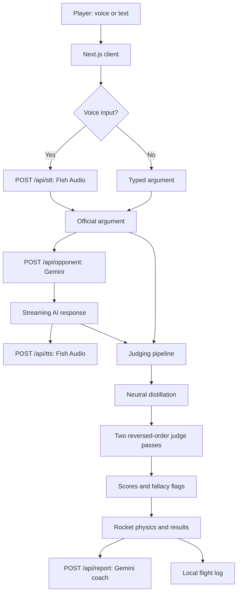

<div align="left">

#  DEB“AI”
### Debate Trajectory Control

**Make your argument. Defend your position. Launch your rocket.**

An AI-powered debate training game where stronger arguments propel your rocket through space. Debate a conversational AI opponent, receive transparent feedback from an independent AI judge, and race to the Moon, Mars, Jupiter, or Saturn.

**Built for HackRPI 2026 — “In the Clouds”**

[**🎮 Play the Live Demo**](https://debai-five.vercel.app/)

</div>

## The problem

Traditional debate practice often depends on finding a partner, arranging time together, and getting useful feedback from a coach or judge. Practicing alone rarely recreates the pressure of a live exchange, and a simple chatbot conversation doesn't make progress easy to measure.

**DEB“AI” makes debate practice available on demand.** It combines a responsive AI opponent, voice-based turn-taking, structured argument assessment, and a visual rocket race that makes each exchange matter.

## What makes it different

- **Debate by voice or text.** Speak naturally with hands-free turn detection or type your argument.
- **Three opponent difficulties.** Choose Easy, Medium, or Hard, each with a distinct reasoning style.
- **Optional live interruptions.** The opponent can interrupt hesitation; you can interrupt the opponent by speaking over it.
- **Independent AI judging.** Arguments are evaluated separately from the AI opponent's responses.
- **Bias-reduction pipeline.** Arguments are distilled into neutral points and judged twice with reversed speaker order.
- **Real-time rocket race.** Argument scores determine speed, boosts, momentum, and stalls.
- **Four destinations.** The Moon, Mars, Jupiter, and Saturn each offer different race lengths and limits.
- **Detailed coaching.** Review category scores, fallacies, strong points, rewritten arguments, and a 60-second practice drill.
- **Progress tracking.** See per-exchange performance and historical averages, with past debates saved locally.
- **Simulation fallback.** Explore the experience even without configured AI credentials.

## How it works

1. **Set your mission:** choose one of 23 built-in topics or enter your own, pick FOR or AGAINST, select difficulty and a destination, and optionally enable interruptions.
2. **Make your case:** talk into your microphone or type your argument. Spoken turns are transcribed through Fish Audio.
3. **Hear the response:** Gemini generates a conversational counterargument; Fish Audio speaks it aloud as streamed sentences arrive.
4. **Get scored:** a separate judging pipeline evaluates both sides across five criteria, each worth 0–4 points.
5. **Watch the race:** scores translate into rocket movement. Strong turns create boosts; sustained strong turns build momentum; flagged fallacies reduce movement.
6. **Review your results:** see the winner, judge explanations, skill charts, coaching report, and saved flight log.

### Difficulty levels

| Level | Profile | Behavior |
| --- | --- | --- |
| Easy | IQ 95 persona | Everyday reasoning, simple examples, occasional weak arguments |
| Medium | IQ 110 persona | Clear, mostly accurate points from a well-read non-expert |
| Hard | IQ 120 persona | Sharper analysis, more precise evidence, and targeted rebuttals |

*The IQ numbers are in-game persona labels, not actual IQ measurements or scientific assessments.*

### Missions

| Destination | Distance | Max exchanges | Time limit | User rocket | AI rocket |
| --- | ---: | ---: | ---: | --- | --- |
| Moon | 240,000 mi | 6 | 9 min | Saturn V | Atlas V |
| Mars | 140 million mi | 13 | 19.5 min | Starship | Falcon Heavy |
| Jupiter | 390 million mi | 20 | 30 min | Titan IIIE | Ariane 5 |
| Saturn | 790 million mi | 26 | 39 min | SLS | New Glenn |

*Distances and speeds are gameplay parameters, not a physical spaceflight simulation.*

## Scoring and fairness

Each debater receives **up to 20 points per exchange**:

| Criterion | Range | What it measures |
| --- | --- | --- |
| Claim | 0–4 | Clarity and soundness of the position |
| Evidence | 0–4 | Relevant support and reasoning |
| Rebuttal | 0–4 | How well the argument answers the opposing point |
| Relevance | 0–4 | Whether the argument stays on the motion |
| Confidence | 0–4 | Observable pauses, filler, and stuttering in spoken delivery |

The judging pipeline is designed to focus on **the strength of ideas rather than polished wording**:

1. Gemini independently distills each turn into short, neutral claims, evidence, and rebuttals, while preserving unsupported assertions and reasoning problems.
2. The judge assesses the distilled arguments, not grammar, accent, length, or verbal polish.
3. Two judging passes run in parallel with anonymous speaker labels in reversed order; their scores are averaged. A fallacy is counted only when both passes flag it.
4. Confidence is calculated separately from speech signals. Typed turns receive a neutral confidence score of 2. Opening rebuttal scores also receive a neutral 2 because neither side has a previous argument to answer.
5. Placeholder scores are excluded from relevant skill-average comparisons so they do not distort weakness tracking.

These safeguards aim to reduce bias; they do **not** guarantee objective or perfectly consistent AI judgments.

### Rocket movement

The core race update is:

```text
V_next = V_current + (S × K) + (max(0, S − S_opponent) × B)
D_next = D_current + (V_next × 60)
```

Where `S` is the debater's turn score out of 20, `K` is the destination's base acceleration multiplier, `B` is its winning-margin bonus, `V` is game velocity, and `D` is distance traveled. Destination-specific constants are defined in `lib/game.ts`.

- **Momentum:** three consecutive strong turns (at least 15/20) add a `2K` bonus.
- **Fallacy stall:** a flagged fallacy halves distance gained that turn.
- **Victory:** first to reach the destination wins. If the exchange or time limit ends first, the closer rocket wins. Equal distance is broken by total score; equal distance and score is a draw.

## Voice and interruptions

The browser records spoken arguments with `MediaRecorder`, sends compressed audio to Fish Audio for transcription, and optionally displays live captions through the Web Speech API. **The Fish Audio transcript, not the live captions, is the official spoken argument used for judging.**

Gemini's response is streamed sentence by sentence and voiced by Fish Audio. Optional interruptions support two-way conversational pressure: the AI may cut in when you stall or run long, while speaking over the AI for roughly half a second can stop its reply. Only the opponent's audible portion is judged after an interruption. Using headphones is recommended to avoid microphone feedback.

## Tech stack

| Layer | Technology |
| --- | --- |
| Web application | Next.js, React, TypeScript |
| Styling | Tailwind CSS v4, shadcn/ui, Radix UI |
| Animation | Motion (`motion/react`) |
| Charts | Recharts |
| Game state | React `useReducer` |
| AI opponent, distillation, judge, coach | Gemini via `@google/genai` |
| Speech-to-text and AI voice | Fish Audio |
| Browser speech features | MediaRecorder, Web Speech API |
| Hosting | Vercel |
| Debate history | Browser `localStorage` |

### System architecture



All external API keys are intended to stay in server-side Next.js routes.

## Run locally

**Prerequisites:** Node.js and npm, plus optional Gemini and Fish Audio API credentials for the full AI/voice experience.

```bash
# Clone your repository
 git clone <YOUR_REPOSITORY_URL>
 cd <YOUR_REPOSITORY_FOLDER>

# Install dependencies
npm install

# Create a local environment file
cp .env.example .env.local

# Start the development server
npm run dev
```

Open **http://localhost:3000**. On Windows PowerShell, use `Copy-Item .env.example .env.local` instead of `cp` if needed.

Without a Gemini key, the app uses a canned opponent and keyword-based simulation judge. Without Fish Audio credentials, voice input/output is unavailable and you can still type. The setup screen indicates integration status.

### Environment variables

Configure these in `.env.local` for local development or in your Vercel project's Environment Variables settings:

| Variable | Purpose |
| --- | --- |
| `GEMINI_API_KEY` | Gemini opponent, distiller, judge, and report |
| `GEMINI_MODEL` | Opponent/distiller/report model; project default `gemini-3.8-flash` |
| `GEMINI_JUDGE_MODEL` | Optional judge model override; otherwise uses `GEMINI_MODEL` |
| `FISH_AUDIO_API_KEYS` | Comma-separated Fish Audio keys for rotation |
| `FISH_AUDIO_API_KEY` | Alternative single-key configuration |
| `FISH_AUDIO_API_KEY_2` through `_4` | Additional individual keys |
| `FISH_AUDIO_OPPONENT_VOICE_ID` | Opponent voice ID |
| `FISH_AUDIO_MODEL` | TTS model; default `s2.1-pro` |
| `FISH_AUDIO_STT_MODEL` | Transcription model; default `transcribe-1-pro` |

Do not commit `.env.local`, real keys, credentials, or private recordings. The TTS model must support the bracketed emotion cues used by the voice prompts.

## Deploy to Vercel

1. Push the project to GitHub.
2. Import it at [vercel.com/new](https://vercel.com/new).
3. Add the required environment variables in the Vercel dashboard.
4. Deploy. If your production branch is `main`, subsequent pushes can trigger production deployments.
5. Test microphone permission, speech transcription, AI responses, judging, and the full results flow on the deployed HTTPS site.

**Deployment considerations:** serverless function duration limits; compressed `webm`/`ogg` audio uploads to stay under the 4.5 MB request-body cap; Fish Audio concurrency/rate limits; and retry handling for transient Gemini/Fish Audio errors. The implementation supports multiple Fish Audio keys and limited concurrent voice requests.

## Project structure

```text
app/
  api/                 # opponent, judge, report, tts, stt, status
  globals.css          # Tailwind tokens and global styles
components/
  SetupScreen.tsx      # Topic, side, difficulty, mission, flight log
  RaceScreen.tsx       # Debate turns, timer, telemetry
  RaceTrack.tsx        # Rocket movement and boost effects
  ResultsScreen.tsx    # Scores, verdict, feedback
  SkillTracker.tsx     # Performance charts
  visuals.tsx          # Rockets, planets, space visuals
  hud.tsx              # Shared interface components
  reveal.tsx           # Scroll reveal helpers
  ui/                  # shadcn/ui components
lib/
  game.ts              # Game rules, topics, destinations, physics
  client/
    raceReducer.ts     # Client state machine
    api.ts             # API requests and stream handling
    audio.ts           # Speech playback queue
    useRecorder.ts     # Microphone recording
    useLiveCaptions.ts # Browser captions
    voiceActivity.ts   # Voice activity detection
    turnMonitor.ts     # Turn-end and interruption logic
    history.ts         # Local flight log
  server/
    prompts.ts         # Gemini prompts and schemas
    gemini.ts          # Gemini client and retries
    fish.ts            # TTS, STT, key rotation
    mock.ts            # Keyless simulation
```

## Engineering highlights

- **Streaming responses and audio playback** reduce perceived delay between the player's argument and the AI's reply.
- **Asynchronous judging** lets the next turn begin while scores are being calculated.
- **Pure turn-monitoring functions** separate voice interruption logic from UI rendering.
- **Reducer-driven race state** coordinates turn transitions, scoring, rocket progress, and end conditions.
- **Server-side API routes** keep provider credentials away from browser code.
- **Reduced-motion support** makes intensive rocket animations more accessible.
- **Local-first history** avoids requiring a user account for saved debate results.

## Limitations and future improvements

AI judgments may be inconsistent or factually wrong; the project is a **practice tool**, not a certified debate evaluation system. Voice recognition, interruptions, and confidence measurements can vary by browser, microphone quality, and background noise. Browser-local history does not sync between devices.

Potential next steps include verified evidence citations, multiplayer debates, user-controlled judging rubrics, exportable coaching reports, and optional cloud-synced progress. These are **ideas, not current features**.

## Hackathon theme: In the Clouds

DEB“AI” interprets the theme in two ways: the game visually launches rockets through clouds and into space, while cloud-hosted AI models provide the opponent, assessment, and coaching. The result turns an abstract learning exercise into a visible, competitive experience.

## Credits

Created for **HackRPI 2026**. Built with Gemini, Fish Audio, Next.js, and Vercel.

> **Project team:** Add contributor names and GitHub profile links here before publishing.
>
> **License:** Add a `LICENSE` file and specify the license here if you want to make reuse terms explicit.

---

<div align="center">

**Your words are your fuel. How far can your argument take you?**

[Launch DEB“AI”](https://debai-five.vercel.app/)

</div>